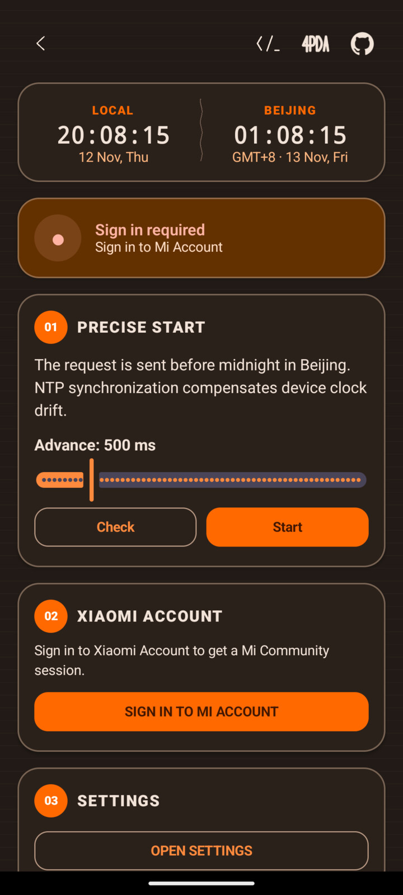
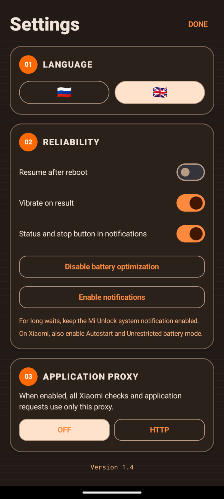

# MiUnlockApp

**A companion for applying to unlock a Xiaomi bootloader and for unlocking it straight from a phone.**

> [!IMPORTANT]
> MiUnlockApp is an independent app and is not affiliated with Xiaomi. It helps prepare and send the standard application, but Xiaomi decides whether to grant access.

## Screenshots

  
  
  
  
  

## What It Does

Two independent modes: **unlock application** and **bootloader unlock**.

Unlock mode:

- Works like a PC: the target phone is connected to this phone over an OTG cable in fastboot.
- Its own Mi Account session, separate from the application mode.
- Reads the device token, checks the data wipe, gets the Xiaomi signature and hands it to the bootloader.
- Asks for confirmation before the irreversible step and logs every stage.
- Clear status: how many hours are left to wait or which step it stopped at.

Application mode:

- Sign in with a Xiaomi Account directly in the app, including QR sign-in.
- Check whether the account is ready for an unlock application.
- Measure Xiaomi API response time during the check and automatically set a recommended request advance.
- Wait for the right time and send the application automatically.
- Optionally route Xiaomi Account sign-in, API checks, and the application request through an HTTP proxy.
- Stay active in the background with the screen off.
- Show a live status in notifications, including a stop button.
- Detailed log of every step with a “Copy full log” button — if something fails, the whole log is one tap away.
- Switch between Russian and English in the settings of either mode.
- Keep account details on the device only.
- Run on both 64-bit (arm64-v8a) and 32-bit (armeabi-v7a) ARM devices.

## Install

1. Download the latest APK from **Releases**.
2. Allow installation from the app you used to download the file.
3. Install and open MiUnlockApp.

## Compatibility

- Android 8.0 (API 26) or newer.
- ARM processors: **arm64-v8a** (ARMv8, 64-bit) and **armeabi-v7a** (ARMv7, 32-bit).
- x86/x86_64 phones are not supported: the APK ships only ARM native libraries.
- Unlock mode needs USB host (OTG): the target phone is connected to this phone.

## How To Use

The app opens with the mode selection screen.

### Bootloader unlock

1. Pick **Bootloader unlock**.
2. Sign in to Mi Account — this is a separate session.
3. Make sure the application is approved (the **Unlock application** mode shows
   that the account has permission). **Binding works only after approval**: the
   phone will not accept it before that.
4. On the target phone, sign in to the **same** account and link it:
   Settings → Additional settings → Developer options →
   **Mi Unlock status** → “Add account and device”.
5. Linking starts a mandatory waiting period on Xiaomi's side. While it runs,
   **do not add the account on the phone again** — the countdown restarts from
   scratch. The app shows how many hours are left.
6. Put the target phone into fastboot (power off, then hold Volume Down and Power).
7. Connect it to this phone with an OTG cable. **Do this before starting the
   unlock**: a device connected in advance is detected more reliably.
8. Tap **Find device** and allow USB access.
9. Tap **Unlock** and confirm the data wipe.

The account must be linked on the very phone you are unlocking: the
account-and-device pair is unique, so a link made on another phone does not count.

### Unlock application

1. Open **Settings** and tap **Enable notifications**.
2. Tap **Disable battery optimization** and allow it.
3. On Xiaomi phones, also allow Autostart and set battery use to **No restrictions**.
4. Return to the main screen and sign in to your Xiaomi Account.
5. Tap **Check** to see the account status.
6. Optionally configure and test an HTTP proxy in **Settings** before the check.
7. Tap **Start** when the account is ready.
8. The app keeps working in the background. The notification shows its current status and lets you stop it at any time.

## Important

- Use the app only with your own Xiaomi Account.
- Keep your phone connected to the internet while it is waiting.
- Do not close the app from the recent-apps screen while it is working.
- The final decision and any waiting period are controlled by Xiaomi.
- In unlock mode, do not unplug the OTG cable before the operation finishes: the
  bootloader must receive the signature and the command back to back.
- Unlocking erases everything on the target phone. Back it up beforehand.

## Privacy

- Your password and one-time verification code are used only while you sign in and are not saved.
- The app keeps the session needed for the application on your device.
- If configured, proxy address and credentials are kept locally on the device to use the chosen proxy for Xiaomi API requests.
- Without a configured proxy, account details are sent only to Xiaomi. A proxy provider can observe connection metadata; use only a proxy you trust.

## Community

Questions, test builds and feedback live in the [4PDA thread](https://4pda.to/forum/index.php?showtopic=1124335). The app has a 4PDA button in the header that opens it.

## License

This project is available under the [MIT License](LICENSE).

Made for Android with ChatGPT 5.6 Terra and DeepSeek-V4.1 Flash ❤️

