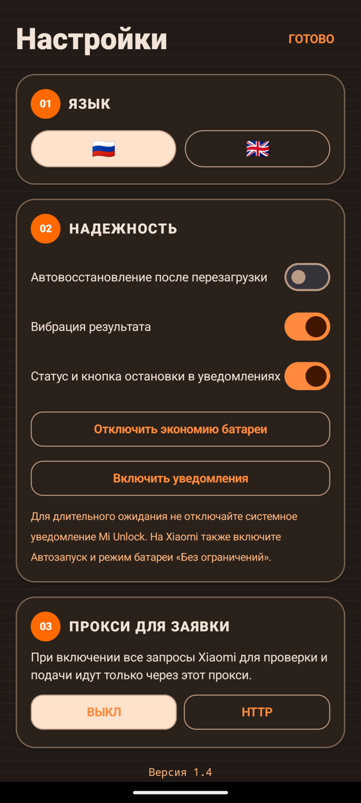

# MiUnlockApp

**Приложение для заявки на разблокировку загрузчика Xiaomi и самой разблокировки с телефона.**

> [!IMPORTANT]
> MiUnlockApp - независимое приложение и не связано с Xiaomi. Оно помогает подготовить и отправить обычную заявку, но решение о выдаче доступа принимает Xiaomi.

## Скриншоты

  
  
  
  
  

## Возможности

Два независимых режима: **подача заявки** и **разблокировка загрузчика**.

Режим разблокировки:

- Работает как ПК: телефон подключается ко второму телефону по OTG-кабелю в режиме fastboot.
- Своя сессия Mi Account, отдельная от режима заявки.
- Чтение токена устройства, проверка стирания данных, подпись Xiaomi и передача её загрузчику.
- Подтверждение перед необратимой операцией и подробный журнал шагов.
- Понятный статус: сколько часов осталось ждать или на каком шаге всё встало.

Режим заявки:

- Вход в Xiaomi Account прямо в приложении, включая QR-вход.
- Проверка, готов ли аккаунт к подаче заявки.
- Измерение времени ответа Xiaomi API при проверке и автоматическая установка рекомендуемого смещения.
- Ожидание нужного времени и автоматическая отправка заявки.
- Необязательная отправка входа Xiaomi Account, проверок и заявки Xiaomi API через HTTP-прокси.
- Работа в фоне и с выключенным экраном.
- Постоянный статус в уведомлениях и кнопка остановки.
- Подробный журнал всех действий с кнопкой «Копировать весь лог» — если что-то не сработало, лог можно отправить одним нажатием.
- Переключение между русским и английским языком одним нажатием в настройках любого режима.
- Данные аккаунта остаются на устройстве.
- Работа на 64-битных (arm64-v8a) и 32-битных (armeabi-v7a) ARM-устройствах.

## Установка

1. Скачайте последний APK из раздела **Releases**.
2. Разрешите установку приложений из источника, которым был скачан файл.
3. Установите и откройте MiUnlockApp.

## Совместимость

- Android 8.0 (API 26) и новее.
- ARM-процессоры: **arm64-v8a** (ARMv8, 64 бита) и **armeabi-v7a** (ARMv7, 32 бита).
- Телефоны на x86/x86_64 не поддерживаются: в APK только ARM-библиотеки.
- Для режима разблокировки нужен USB-host (OTG): целевой телефон подключается к этому же телефону.

## Как пользоваться

При запуске открывается меню выбора режима.

### Разблокировка загрузчика

1. Выберите **Разблокировка загрузчика**.
2. Войдите в Mi Account — это отдельная сессия.
3. Переведите целевой телефон в fastboot (выключить, затем Громкость− и Питание).
4. Подключите его к этому телефону через OTG-кабель.
5. Нажмите **Найти устройство** и разрешите доступ к USB.
6. Нажмите **Разблокировать** и подтвердите стирание данных.

### Подача заявки

1. Откройте **Настройки** и нажмите **Включить уведомления**.
2. Нажмите **Отключить экономию батареи** и подтвердите разрешение.
3. На Xiaomi также включите Автозапуск и режим батареи **Без ограничений**.
4. Вернитесь на главный экран и войдите в Xiaomi Account.
5. Нажмите **Проверить**, чтобы узнать состояние аккаунта.
6. При необходимости настройте и проверьте HTTP-прокси в **Настройках** до проверки.
7. Если аккаунт готов, нажмите **Запустить**.
8. Приложение продолжит работу в фоне. В уведомлении виден текущий статус и кнопка остановки.

## Важно

- Используйте приложение только со своим Xiaomi Account.
- Пока приложение ждёт, телефон должен быть подключен к интернету.
- Не закрывайте приложение через список последних приложений во время работы.
- Итоговое решение и срок ожидания устанавливает Xiaomi.

## Конфиденциальность

- Пароль и одноразовый код используются только во время входа и не сохраняются.
- Нужная для заявки сессия хранится только на устройстве.
- Если прокси настроен, его адрес и данные входа хранятся локально на устройстве, чтобы все запросы Xiaomi API шли через выбранный прокси.
- Без настроенного прокси данные аккаунта отправляются только Xiaomi. Провайдер прокси может видеть метаданные подключения, поэтому используйте только доверенный прокси.

## Лицензия

Проект распространяется по лицензии [MIT](LICENSE).

Сделано на Android с помощью ChatGPT 5.6 Terra и DeepSeek-V4.1 Flash ❤️

